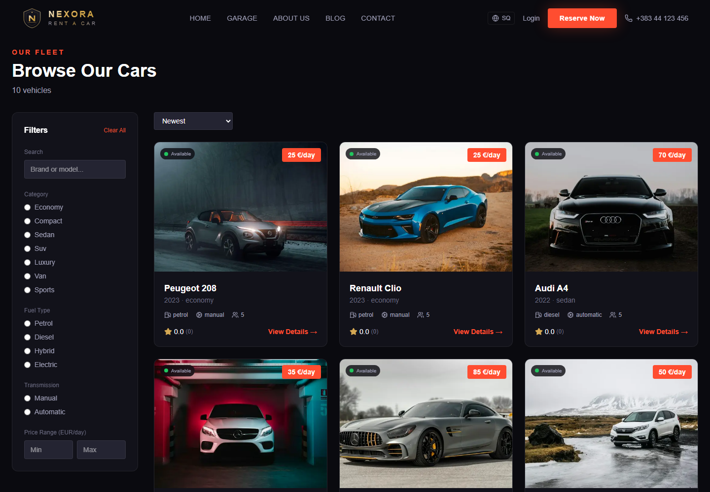
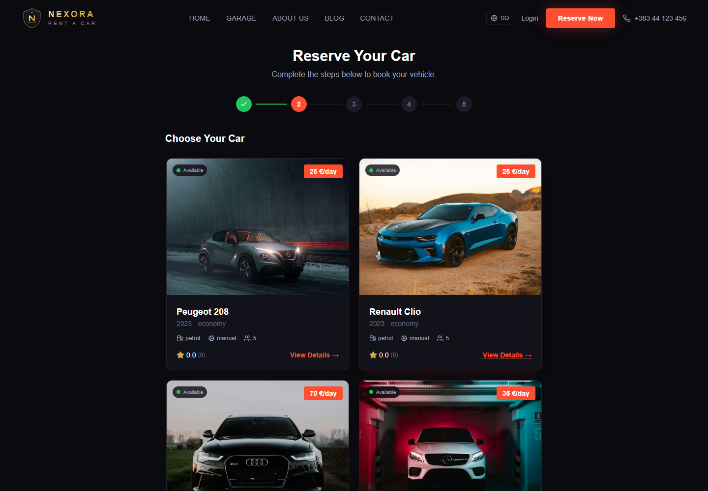
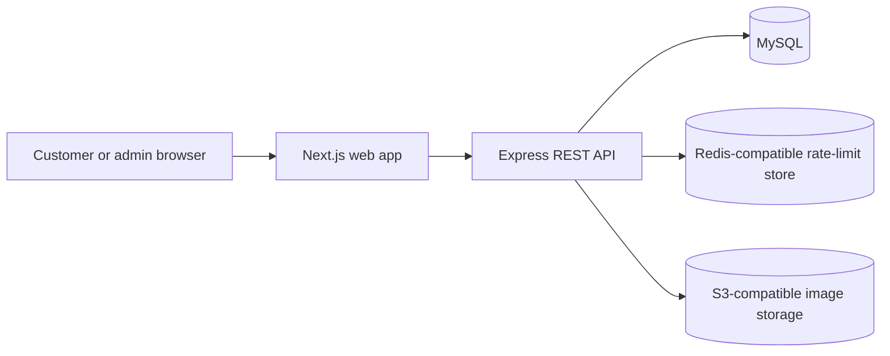

# Nexora Rent a Car


Nexora Rent a Car is a full-stack vehicle-rental platform for browsing a fleet, submitting reservations, and managing rental operations. The repository contains a Next.js customer experience and an Express API backed by MySQL.

> **Status:** The project includes local development tooling and automated tests, but this repository does not provision production infrastructure. Review [Production operations](./OPERATIONS.md) before deployment. In particular, backups, restore drills, staging, monitoring, and rollback must be configured and verified with the hosting providers.

## Product preview

These screenshots were captured from the running application using local development data.

### Landing page


### Vehicle catalogue



### Reservation flow



Admin pages are available after signing in with an authorized staff account. Admin screenshots are intentionally not published here because they can expose customer and reservation data.

## What’s included

### Customer experience

- Browse and filter vehicles by category, fuel type, transmission, and price.
- Review vehicle details, daily pricing, and available extras.
- Submit a reservation as a signed-in customer or as a guest with contact details.
- View and cancel eligible reservations from the customer account.
- Register, sign in, and manage an authenticated session.
- Use the interface in English or Albanian.

### Admin experience

- Manage vehicles, reservations, and customers.
- Review revenue, pricing, maintenance, deliveries, messages, reviews, and site settings.
- Apply role-based access controls to administrative routes.
- Record admin mutation metadata and reservation change summaries.

### Backend and reliability

- REST API with request validation, structured logging, request IDs, and health reporting.
- MySQL-backed reservation workflows with overlap checks and per-car serialization.
- Hashed, rotating refresh-token sessions with logout/revocation support.
- Shared Redis-compatible rate limits and S3-compatible image storage in production.
- MySQL migrations, unit tests, database integration tests, and Playwright browser tests.

## Architecture



Redis and object storage are required by the API in production. In development, the API can use process-local rate limits and local image storage. The production API health endpoint reports the database, rate-limit store, and image-storage mode.

## Technology

| Area | Technologies |
|---|---|
| Web | Next.js 16, React 19, TypeScript, Tailwind CSS 4, Zustand |
| API | Node.js 22, Express 4, Zod, JWT |
| Database | MySQL 8.4-compatible; accessed through `mysql2` |
| Production integrations | Redis-compatible shared rate limiting; S3-compatible media storage |
| Quality | Node.js test runner, MySQL integration tests, Playwright, ESLint |
| CI | GitHub Actions: MySQL migrations/integration, browser workflows, lint, build, and dependency audits |

## Getting started

### Prerequisites

- Node.js 22 and npm
- Docker Desktop with Docker Compose, or a local MySQL-compatible database
- Git

### 1. Install dependencies

Run these commands from the repository root:

```sh
npm install
npm install --prefix server
npm install --prefix client
```

### 2. Configure local environment

Copy the example file to the repository root for Docker Compose and to `server/.env` for the API:

```powershell
Copy-Item .env.example .env
Copy-Item .env.example server/.env
```

On macOS/Linux, use `cp .env.example .env` and `cp .env.example server/.env`.

Edit both files and replace the example database passwords. `MYSQL_PASSWORD` in the root `.env` must match `DB_PASSWORD` in `server/.env`; keep the database name, user, and port consistent as well. The example uses MySQL on `127.0.0.1:3307`.

Create `client/.env.local`:

```env
NEXT_PUBLIC_API_URL=http://localhost:4000/api/v1
NEXT_PUBLIC_SITE_URL=http://localhost:3000
```

Do not commit `.env`, `server/.env`, or `client/.env.local`.

### 3. Start MySQL and apply migrations

The included Compose file is for local development only and binds MySQL to loopback:

```sh
docker compose up -d
npm run db:migrate
```

If you use an existing local MySQL instance instead, configure its connection in `server/.env` and create the `drenas_rentacar` database before running migrations.

### 4. Start the application

From the repository root:

```sh
npm run dev
```

The web app is available at [http://localhost:3000](http://localhost:3000), the API at [http://localhost:4000/api/v1](http://localhost:4000/api/v1), and the API health endpoint at [http://localhost:4000/api/health](http://localhost:4000/api/health).

The root `dev` script starts the web app and API together. Alternatively, start each service in its own terminal with `npm --prefix server run dev` and `npm --prefix client run dev`.

## Development commands

| Command (from repository root) | Purpose |
|---|---|
| `npm run dev` | Start the API and web app |
| `npm run db:migrate` | Apply pending MySQL migrations |
| `npm run db:seed` | Insert development seed data |
| `npm run db:reset` | Apply migrations and seed data |
| `npm --prefix server test` | Run backend unit tests |
| `npm --prefix client run lint` | Run frontend ESLint |
| `npm --prefix client run build` | Build the frontend for production |

### Database integration tests

Backend integration tests need a migrated MySQL database. In PowerShell:

```powershell
$env:RUN_DB_INTEGRATION_TESTS = "1"
npm --prefix server test
Remove-Item Env:RUN_DB_INTEGRATION_TESTS
```

### Browser end-to-end tests

After applying migrations, prepare the isolated E2E admin account using test mode, install Chromium once, then run the Playwright workflows:

```powershell
$env:NODE_ENV = "test"
npm --prefix server run test:e2e:prepare
Remove-Item Env:NODE_ENV
```

```sh
cd client
npx playwright install chromium
npm run test:e2e
```

Playwright starts the app services when they are not already running. The E2E setup script refuses to run unless `NODE_ENV=test`; its test credentials are for local/CI verification only.

## Configuration

See [`.env.example`](./.env.example) for the local Compose and application variables.

| Variable | Used by | Purpose |
|---|---|---|
| `DB_HOST`, `DB_PORT`, `DB_NAME`, `DB_USER`, `DB_PASSWORD` | API | Runtime MySQL connection |
| `JWT_SECRET`, `JWT_REFRESH_SECRET` | API | Separate access-token and refresh-token signing secrets |
| `CLIENT_URL` | API | Allowed browser origins; HTTPS origins are required in production |
| `NEXT_PUBLIC_API_URL`, `NEXT_PUBLIC_SITE_URL` | Web build | Public API and site URLs |
| `REDIS_URL` | API | Shared production rate-limit storage |
| `OBJECT_STORAGE_BUCKET`, `OBJECT_STORAGE_REGION`, `OBJECT_STORAGE_PUBLIC_URL` | API | Production image storage and public media URL |
| `OBJECT_STORAGE_ENDPOINT`, `OBJECT_STORAGE_FORCE_PATH_STYLE` | API | Optional S3-compatible provider settings |
| `MIGRATION_DB_USER`, `MIGRATION_DB_PASSWORD` | Release migration step | Separate production migration account |

Production startup validates its required database, HTTPS, secret, Redis, and object-storage configuration. Supply object-storage credentials through the hosting provider’s workload identity or secret manager; do not put credentials in the repository. See [OPERATIONS.md](./OPERATIONS.md) for deployment, migration, health, backup, restore, and rollback guidance.

## API overview

Base URL: `http://localhost:4000/api/v1`

| Method | Route | Description |
|---|---|---|
| `POST` | `/auth/register` | Register a customer |
| `POST` | `/auth/login` | Authenticate a user |
| `GET` | `/cars` | Browse vehicles with filters and pagination |
| `GET` | `/cars/:id/availability` | Check vehicle availability for a date range |
| `GET` | `/locations` | List pickup and drop-off locations |
| `GET` | `/extras` | List bookable rental extras |
| `POST` | `/reservations` | Create a guest or authenticated reservation |
| `GET` | `/reservations/mine` | List the signed-in customer’s reservations |
| `GET` | `/admin/*` | Administrative APIs; authentication and role checks apply |

The availability check and reservation service use the same blocking reservation statuses. Reservation creation serializes updates by car to prevent overlapping requests from both succeeding.

## Repository layout

```text
client/                 Next.js application and Playwright browser tests
  app/                  Customer and admin routes
  components/           Shared UI and admin components
  e2e/                  Customer and admin browser workflows
  lib/                  API client and utilities
  stores/               Zustand state stores
server/                 Express API
  src/db/migrations/    MySQL schema and data migrations
  src/db/seeds/         Development seed script
  src/routes/           REST endpoints
  src/services/         Booking, auth-session, and domain logic
  test/                 Unit and MySQL integration tests
docs/screenshots/       Product screenshots used in this README
```

## Production and data safety

- This repository does **not** create a production deployment, managed database, Redis service, object-storage bucket, backup schedule, or monitoring integration.
- The current migration history includes local/demo fixture data, and the standalone development seed script creates a known admin credential. Review and remove or replace these fixtures and seed behavior before using the migration chain in a production environment. Never run development seed/reset commands against production.
- Use separate least-privilege runtime and migration database users, strong unique JWT secrets, HTTPS, a shared Redis-compatible rate-limit store, and durable object storage.
- Audit rows are written before successful admin mutation responses are returned, but the audit write and business mutation are not an atomic transactional outbox.
- Backups, restore drills, provider-specific deployment, and rollback must be tested and documented outside this repository before accepting real customer bookings.

For the full release checklist and known limitations, read [Production operations](./OPERATIONS.md).

## Contributing

1. Create a focused branch from `main`.
2. Make changes with corresponding tests and documentation.
3. Run the relevant backend tests, frontend lint/build, and browser tests.
4. Open a pull request. CI runs database-backed tests, browser workflows, lint/build, and dependency audits.

Avoid committing credentials, customer data, local environment files, or generated test artifacts.
